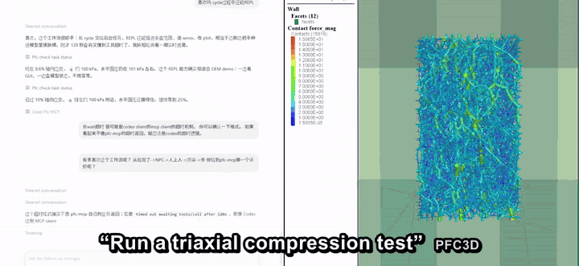

<p align="center">
  
</p>

# itasca-mcp

[English](https://github.com/yusong652/itasca-mcp/blob/main/README.md) | [简体中文](https://github.com/yusong652/itasca-mcp/blob/main/README.zh-CN.md)

[](https://github.com/yusong652/itasca-mcp/actions/workflows/test.yml)
[](https://pypi.org/project/itasca-mcp/)
[](https://pepy.tech/project/itasca-mcp)
[](https://github.com/yusong652/itasca-mcp/stargazers)
[](LICENSE)
[](https://www.python.org/)

`itasca>model new ;now, with LLM.`

**itasca-mcp** connects AI agents to [ITASCA](https://www.itascacg.com/)'s geomechanics simulation software — PFC, FLAC, 3DEC, MPoint, and MassFlow — through the [Model Context Protocol](https://modelcontextprotocol.io/). Browse documentation, run simulations, and execute code, all through natural conversation.

`itasca>model solve ;LLM solves.`



## Tools (7)

**2 documentation tools** — browse by path and search by keywords across the selected engine's commands, Python API, FISH intrinsics, and reference docs. No bridge required.

**5 execution tools** — interactive REPL, task submission, progress monitoring, interruption, and history. Requires bridge.

## Example Prompts

- *"Run a biaxial compression test on a dense specimen and plot the stress–strain curve"*
- *"Build a slope model in FLAC3D and find the factor of safety"*
- *"Model a tunnel excavation in jointed rock with 3DEC and check block displacements around the opening"*
- *"Simulate a landslide runout with MPoint and report the final deposit profile"*
- *"The simulation is still running, check the current unbalanced force without stopping it"*
- *"Look up the `plot` commands in the docs, then plot the contact force chains of the current model"*
- *"The command I just typed in the console doesn't seem right, take a look"*

## First-time Setup

### Prerequisites

- **An ITASCA engine installed** — PFC, FLAC, 3DEC, MPoint, or MassFlow. The Subscription release (9.0+) is recommended; PFC 6.0 / 7.0, FLAC 7.0, and 3DEC 7.0 are also supported.
- **[uv](https://docs.astral.sh/uv/getting-started/installation/)** installed (for `uvx`)
- **An AI agent** — Claude Code, Codex CLI, Gemini CLI, or any MCP-capable client

### Agentic Setup (Recommended)

Copy this to your AI agent and let it self-configure:

```text
Fetch and follow this bootstrap guide end-to-end:
https://raw.githubusercontent.com/yusong652/itasca-mcp/main/docs/agentic/itasca-mcp-bootstrap.md
```

### Manual Setup

**1. Register the MCP server** with your agent.

Most agents register it with a single command:

```bash
# Claude Code
claude mcp add itasca-mcp -- uvx itasca-mcp

# Codex / Codex-cli
codex mcp add itasca-mcp -- uvx itasca-mcp

# Gemini CLI
gemini mcp add itasca-mcp uvx itasca-mcp
```

Or fill in the MCP config file manually:

```json
{
  "mcpServers": {
    "itasca-mcp": {
      "command": "uvx",
      "args": ["itasca-mcp"]
    }
  }
}
```

**2. Install the bridge into the engine's Python.** In a terminal, run pip with the interpreter bundled in the engine's install directory (`exe64/python310` for the Subscription release, `exe64/python36` for 6.0/7.0). With the default install locations:

```powershell
# Subscription (latest)
& "C:\Program Files\Itasca\Itasca Software Subscription\exe64\python310\python.exe" -m pip install --user -U itasca-mcp-bridge

# 7.0 (FLAC3D shown)
& "C:\Program Files\Itasca\FLAC3D700\exe64\python36\python.exe" -m pip install --user -U itasca-mcp-bridge
```

**3. Start the bridge** in the engine's IPython console (PFC, FLAC, 3DEC, ...):

```python
import itasca_mcp_bridge
itasca_mcp_bridge.start()
```

If pip cannot reach PyPI, paste the contents of [`addon.py`](addon.py) into the engine's IPython console instead: it installs the bridge (with a mirror fallback) and starts it in one go.

### Verify

Restart your AI agent and ask it to call `itasca_execute_code` to verify the connection.

## Daily Startup

Once first-time setup is done, each new engine session only needs the bridge re-started — run this in the engine's IPython console and you're back online:

```python
import itasca_mcp_bridge
itasca_mcp_bridge.start()
```

`start()` checks PyPI for a newer bridge release and self-upgrades before starting. The MCP client config persists.

## Features

- **Multi-engine, multi-version corpus** - command, Python API, and reference docs for PFC, FLAC, 3DEC, MPoint, and MassFlow across engine versions (PFC: 6.0/7.0/9.0, FLAC: 7.0/9.0, 3DEC: 7.0/9.0), selected via the `software` and `version` parameters
- **Documentation agents can navigate** - agents browse the engine command tree to discover capabilities and boundaries, reducing hallucinated commands, with plot item reference docs supplementing the official documentation
- **Live REPL alongside running tasks** - execute code while a simulation is running: check model state and intermediate results without stopping the task; also useful for quick iteration before writing a full script
- **Task lifecycle management** - submit long-running simulations, monitor progress, interrupt running tasks, and browse task history
- **Human-agent interaction in the GUI** - the agent follows what you do in the engine GUI (the code and commands you run, the plots and data files you open or edit), and the files it runs or changes show up in your Project pane and editor, so you and the agent work on the same model at the same time
- **Agent-started bridge** - an AI agent can start the bridge itself through the engine's `console.exe`
- **Multi-client compatible** - works with Claude Code, Codex CLI, Gemini CLI, GitHub Copilot CLI, OpenCode, toyoura-nagisa, and other MCP clients

## Troubleshooting

See [Troubleshooting](docs/agentic/itasca-mcp-bootstrap.md#troubleshooting) in the bootstrap guide.

## Development

See [Developer Guide: Install and Run from Source](docs/development/source-install.md).

<a href="https://glama.ai/mcp/servers/yusong652/itasca-mcp">
  
</a>

## Contributing

PRs and issues are welcome! See [CONTRIBUTING.md](CONTRIBUTING.md) for where changes land and how the
documentation corpus is structured, and the [Developer Guide](docs/development/source-install.md) for the
source install.

## License

MIT - see [LICENSE](LICENSE).

<!-- mcp-name: io.github.yusong652/itasca-mcp -->
